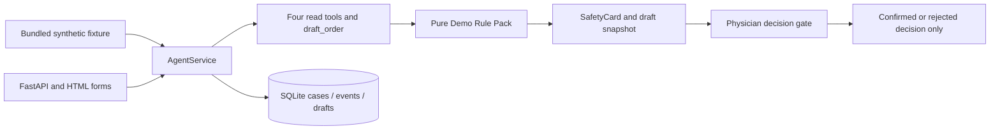

# Architecture

Python 3.11+, FastAPI, Pydantic v2, uvicorn and SQLite. The HTML pages are server-rendered;
there is no frontend framework or external model. This is a local SYNTHETIC-only laboratory,
not a medical device or production system.



`Case` stores business key, synthetic patient/fixture binding, state and UTC timestamps.
`SafetyCard` stores level, rule IDs, missing data, conflicts, explanations and a draft.
`PhysicianDecision` stores confirm/reject, demo role, fictional actor and optional reason
in the event timeline. `RulePack` is the self-authored four-rule module, not a guideline.

The only workflow drafts the fixture's preselected outpatient medication proposal. It
does not infer symptoms, diagnose or select a treatment. Tools run in fixed order:
`get_patient_summary`, `get_labs`, `get_allergies`, `get_medications`, `draft_order`.
Gathered context is revalidated before the pure rule function runs. Tool results are stored
as events; a failure records a generic error type/message and moves the case to `failed`.

```text
accepted → gathering → drafted → awaiting_physician → confirmed | rejected | expired | failed
```

Any nonterminal state may also expire/fail. There are no outbound transitions from a terminal
state. Block confirm returns a conflict, preserving awaiting_physician; rejection remains
possible. Decision and expiry checks share a write transaction. Expiration is lazy on detail,
list, replay and decision, not a scheduled job. A late refused confirmation still commits
the expired state. Confirm/reject require the unauthenticated demo `physician` role.

Every workflow mutation runs under SQLite `BEGIN IMMEDIATE`, with foreign keys enabled.
Unique `clientCaseId` and one `drafts` row per case prevent duplicate work, including after
restarts and concurrent retries. A conflicting fixture for an existing key is HTTP 409.
Draft and card persist together in one transaction; replays return stored snapshots rather
than reevaluating against a changed fixture. The full synchronous loop commits as one unit,
so intermediate states are visible in the timeline after completion, not streamed live.

No execution adapter exists. `MedicationRequest.status` only permits `draft` and intent
only permits `proposal`. Revalidation includes existing model instances. A confirmed
workflow decision never changes the drug request's status. The API has no record-upload
endpoint; all patient fields originate from packaged fictional fixtures.

Local scope: no identity verification, distributed queue, migrations, encryption-at-rest,
production monitoring, hospital integration or clinical validation. SQLite writes serialize;
this is adequate for demonstration and is not a scaling claim. Use loopback binding only.
